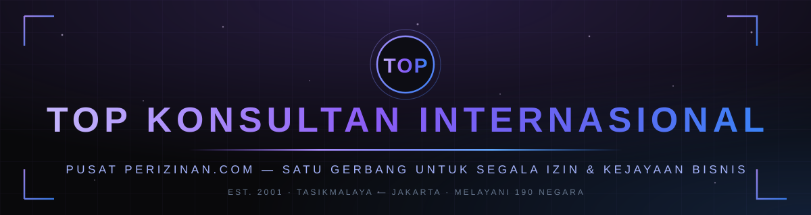
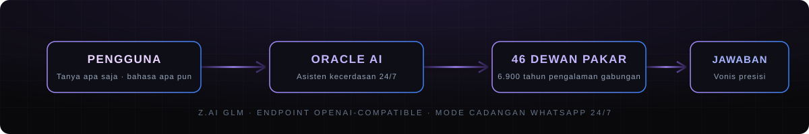

<div align="center">



**Konsultan & Perizinan Terlengkap di Dunia — Melebihi McKinsey, Melebihi Google**

*The World's Most Complete Consultancy & Licensing Firm — Beyond McKinsey, Beyond Google*

<br/>

**◆ PENTA-VERSI v2.2.2.2.2 — "Lima Pilar" ◆**

[](https://github.com/gunaracorp/topkonsultan/blob/main/CHANGELOG.md)
[](https://github.com/gunaracorp/topkonsultan/releases)
[](https://github.com/gunaracorp/topkonsultan/tags)

[](https://github.com/gunaracorp/topkonsultan/actions/workflows/ci.yml)

[](https://nextjs.org)
[](https://react.dev)
[](https://typescriptlang.org)
[](https://tailwindcss.com)

[](https://prisma.io)
[](https://z.ai)
[](#-deploy-ke-vercel-dalam-60-detik)
[](#)

<br/>

[](https://vercel.com/new/clone?repository-url=https%3A%2F%2Fgithub.com%2Fgunaracorp%2Ftopkonsultan&env=AI_API_KEY&project-name=topkonsultan&repository-name=topkonsultan)

**🌐 PILIH BAHASA / CHOOSE LANGUAGE**

[](#-bahasa-indonesia)
[](#-english)

</div>

---

<a id="-penta-versi--lima-pilar"></a>

## ◆ PENTA-VERSI — Lima Pilar

Skema versi lima segmen milik topkonsultan. Setiap segmen punya makna, dan setiap digit saat ini berdiri di angka **2** — lima pilar yang sejajar:

```
v 2 . 2 . 2 . 2 . 2
  │   │   │   │   └── BUILD    — rilis ops/dokumentasi/infra (README, CI, CHANGELOG)
  │   │   │   └────── PATCH    — perbaikan bug & hardening keamanan
  │   │   └────────── MINOR    — set fitur konten (halaman & katalog baru)
  │   └────────────── MAYOR    — era kemampuan besar (Oracle AI, mesin SEO)
  └────────────────── GENERASI — rebuild arsitektur menyeluruh
```

**Mengapa 2.2.2.2.2?** Generasi ke-2 platform (rebuild Next.js), era Mayor ke-2 (Oracle AI + mesin SEO), set Minor ke-2 (674 halaman + 500 jasa), Patch ke-2 (hardening keamanan), Build ke-2 (dokumentasi & versioning) — kelima pilar diselesaikan bersamaan dalam rilis ini. Riwayat lengkap: **[CHANGELOG.md](./CHANGELOG.md)**.

### Matriks Sinkronisasi — 1 Sumber Kebenaran, 12 Titik

Versi **tidak pernah** diketik dua kali secara bebas. Satu nilai kanonik mengalir ke mana-mana:

| # | Titik | Berkas | Cara Sinkron |
|---|---|---|---|
| 1 | **Sumber kebenaran kanonik** | `VERSION` | Ditulis manual saat rilis — satu-satunya tempat mengetik versi |
| 2 | Paket npm/JS | `package.json` | `name: topkonsultan`, `version` |
| 3 | Jantung aplikasi | `src/data/brand.ts` | `BRAND.version` + `BRAND.versionCode` |
| 4 | Manifest PWA | `src/app/manifest.ts` | Otomatis — membaca `BRAND` |
| 5 | Endpoint health | `src/app/api/route.ts` → `GET /api` | Otomatis — membaca `BRAND` |
| 6 | Footer situs | `src/components/landing/footer.tsx` | Otomatis — "Platform v2.2.2.2.2" |
| 7 | Deklarasi manusia | `public/humans.txt` | Manual — dicek penjaga |
| 8 | Sejarah rilis | `CHANGELOG.md` | Entri teratas wajib = versi kanonik |
| 9 | Badge README (3 badge) | `README.md` | Otomatis — shields.io membaca GitHub |
| 10 | Git tag | `v2.2.2.2.2` | Dibuat sekali per rilis |
| 11 | GitHub Release | [Releases](https://github.com/gunaracorp/topkonsultan/releases) | Catatan rilis resmi |
| 12 | **Penjaga sinkronisasi** | `ops/version-check.mjs` | `bun run version:check` + wajib lulus di CI |

> **Jaminan:** `git push` akan **GAGAL di CI** jika satu saja titik tidak sinkron dengan `VERSION`. Versi tidak mungkin melenceng diam-diam.

### Protokol Rilis Versi Baru

```bash
# 1. Naikkan versi di LIMA tempat sumber (semua harus identik):
#    VERSION · package.json · brand.ts (version + versionCode) · humans.txt · CHANGELOG.md
#    (titik turunan — manifest, /api, footer, badge — sinkron otomatis)

# 2. Verifikasi lokal:
bun run version:check    # -> "LULUS: semua 5 titik sinkron"

# 3. Commit, tag, push:
git add -A && git commit -m "release: vX.Y.Z.W.K"
git tag vX.Y.Z.W.K && git push origin main --tags
```

Contoh bump: perbaikan bug saja → `2.2.2.2.3` · halaman baru → `2.2.2.3.1` · fitur besar → `2.2.3.0.0` · rebuild total → `3.0.0.0.0`.

---

<a id="-bahasa-indonesia"></a>

## 🇮🇩 BAHASA INDONESIA

> ❝ *Satu Gerbang untuk Segala Izin dan Kejayaan Bisnis — dari pendirian PT hingga penguasaan pasar di 190 negara.* ❞

Website resmi **PT TOP KONSULTAN INTERNASIONAL** (PUSAT PERIZINAN.COM) — dibangun dengan teknologi web paling modern: **Next.js 16 + React 19 + TypeScript + Tailwind CSS 4**, ditenagai kecerdasan buatan **Z.AI GLM**, siap deploy **zero-config** di Vercel.

<div align="center">

</div>

### ✦ Angka Nyata — Terverifikasi dari Build

*Bukan klaim pemasaran; setiap angka dihitung ulang dari build produksi pada rilis ini.*

| Metrik | Nilai |
|---|---|
| Halaman di-prerender server | **674** |
| URL di `sitemap.xml` | **665** |
| Layanan jasa dalam katalog | **500** (33 kategori) |
| Jenis perizinan yang bisa diurus | **36** |
| Dewan Pakar internasional | **46** |
| Bahasa yang didukung | **195** (+ hreflang per halaman) |
| Logo instansi resmi | **23** |
| Negara yang dilayani | **190** |

### ✦ Fitur Unggulan

| | Fitur | Keterangan |
|---|---|---|
| ◈ | **Oracle AI — Eksklusif VVIP** | Suara bersatu 46 Dewan Pakar di lounge `#/vvip` (kode akses): menjawab perizinan, bisnis, pajak, strategi dalam bahasa apa pun, 24/7 — tidak tampil di situs publik |
| ◈ | **Katalog 500 Jasa + 36 Perizinan** | PT/PMA, NIB, BPOM, Halal, SNI, KITAS, PSE, OJK… satu gerbang untuk segala izin |
| ◈ | **SEO Berlapis Penuh** | URL nyata untuk setiap tampilan, JSON-LD schema.org, hreflang 195 bahasa, sitemap 665 URL — lihat detail di bawah |
| ◈ | **23 Logo Instansi Resmi** | Kemenkumham, BKPM, Kemenkeu, Kemendag, BPOM, OJK, dan lainnya — instansi yang kami hadapi langsung setiap hari |
| ◈ | **Galeri Akreditasi** | Foto asli penyerahan sertifikat & kartu indikasi PUSAT PERIZINAN.COM |
| ◈ | **Form Kontak Bertiket** | Setiap brief terbit nomor tiket unik `TOP-XXXXXX` — tidak ada pesan yang hilang |
| ◈ | **WhatsApp Mengapung 24/7** | Satu ketukan langsung tersambung ke +62 813-1651-6524 |
| ◈ | **Tema Ungu-Biru Futuristik** | Animasi premium, responsif penuh di mobile & desktop, mode animasi-dimatikan untuk aksesibilitas |
| ◈ | **Mode Cadangan Cerdas** | Jika mesin AI tidak tersedia, chat otomatis mengarahkan tamu ke tim manusia — pengunjung tidak pernah melihat error |
| ◈ | **Health Endpoint** | `GET /api` mengembalikan status + versi — siap untuk uptime monitor apa pun |

### ✦ Deploy ke Vercel dalam 60 Detik

1. Klik tombol **Deploy with Vercel** di atas — atau import repository ini di [vercel.com/new](https://vercel.com/new)
2. Biarkan semua pengaturan **default** — semuanya sudah terkonfigurasi otomatis
3. *(Disarankan)* Isi `AI_API_KEY` saat diminta — dapatkan gratis di [Z.AI Open Platform](https://z.ai) agar **Oracle AI hidup penuh**
4. Klik **Deploy** — selesai dalam 2–5 menit. Selanjutnya, setiap `git push` otomatis memperbarui situs

> 💡 Tanpa API key: chat tetap berjalan elegan dengan mode cadangan WhatsApp. Panduan super lengkap untuk pemula: **[DEPLOY.md](./DEPLOY.md)**

### ✦ Environment Variables

| Variabel | Wajib? | Keterangan |
|---|---|---|
| `AI_API_KEY` | Opsional | Mengaktifkan Oracle AI penuh di production — [dapatkan di Z.AI](https://z.ai) |
| `AI_BASE_URL` | Opsional | Default `https://api.z.ai/api/paas/v4` — kompatibel semua penyedia OpenAI-compatible |
| `AI_MODEL` | Opsional | Default `glm-4.6` — alternatif hemat: `glm-4.5-flash` |
| `VVIP_ACCESS_CODE` | Opsional | Kode gerbang lounge `#/vvip` (Oracle). Bawaan: `TOP-VVIP-2026` — rotasi kapan pun tanpa deploy ulang kode |
| `DATABASE_URL` | Opsional | Tanpa variabel ini, form & newsletter berjalan dengan fallback memori |

### ✦ Menjalankan Lokal

```bash
bun install             # atau: npm install
bun run dev             # buka http://localhost:3000
bun run version:check   # verifikasi sinkronisasi PENTA-VERSI
bun run build           # build produksi (identik dengan Vercel)
```

### ✦ Struktur Proyek

```
topkonsultan/
├── VERSION                     # ◆ Sumber kebenaran versi PENTA-VERSI
├── CHANGELOG.md                # ◆ Sejarah rilis (generasi 1 → kini)
├── ops/
│   └── version-check.mjs       # ◆ Penjaga sinkronisasi versi (dipakai CI)
├── src/
│   ├── app/
│   │   ├── [[...slug]]/page.tsx  # URL nyata + generateMetadata + JSON-LD — 665 rute
│   │   ├── layout.tsx            # Metadata global (OG, DC, geo, PWA)
│   │   ├── robots.ts             # robots.txt dinamis (Sitemap + Host)
│   │   ├── sitemap.ts            # sitemap.xml — 665 URL + hreflang
│   │   ├── manifest.ts           # manifest PWA (versi dari BRAND — otomatis)
│   │   └── api/                  # /api (health+versi), oracle, contact, newsletter, vvip
│   ├── components/
│   │   ├── landing/              # Hero, perizinan, akreditasi, instansi, oracle-chat…
│   │   └── site/pages/           # 120+ tampilan (hash-router + URL nyata)
│   ├── data/                     # brand (versi!), jasa (500), offices, leadership, languages (195)
│   └── lib/
│       ├── seo.ts                # ⚙ Mesin SEO terpusat — 1 sumber kebenaran
│       ├── router.tsx            # Hash router v2 — pathname-aware + SSR-safe
│       └── i18n.tsx              # 195 bahasa + dukungan ?lang= (hreflang)
├── public/
│   ├── og-image.png              # Open Graph 1200×630
│   ├── icons/                    # Ikon PWA 192/512/maskable
│   ├── images/                   # Aset branding asli + 23 logo instansi
│   ├── humans.txt                # Konvensi humanstxt.org (+ versi)
│   └── .well-known/security.txt  # Konvensi RFC 9116
├── assets/readme/                # Banner & diagram SVG futuristik
├── prisma/                       # Skema database
├── .github/workflows/ci.yml      # CI Bun: version-check → lint → build
├── vercel.json                   # Konfigurasi deploy otomatis
└── DEPLOY.md                     # Panduan deploy bahasa Indonesia
```

### ✦ SEO & Metadata Terlengkap

Situs ini memakai **satu sumber kebenaran SEO** (`src/lib/seo.ts`) yang menggerakkan seluruh lapisan:

| Lapisan | Isi |
|---|---|
| **URL nyata** | 665 rute (`/perizinan/pendirian-pt`, `/councils/quantum-strategy`, …) di-prerender server — setiap tampilan punya HTML + metadata sendiri, bukan sekadar hash |
| **Metadata per halaman** | `<title>`, deskripsi, keywords, kanonik, Open Graph, Twitter Card, robots — unik di **setiap** halaman (via `generateMetadata`) |
| **hreflang** | 27 tautan per halaman: 26 bahasa terjemahan penuh (`?lang=xx`) + `x-default` |
| **JSON-LD schema.org** | Organization · WebSite (195 `inLanguage`) · LegalService + OfferCatalog 36 izin + 12 praktik · WebPage · BreadcrumbList · Service · Article · FAQPage (10 Q&A) · ItemList · Person |
| **Metadata global** | Dublin Core (DCMI), geo tags, `business:contact_data`, `apple-web-app`, format-detection, ikon lengkap (SVG/PNG/ICO/apple) |
| **sitemap.xml** | 665 URL + prioritas + changeFrequency + hreflang; `/vvip` sengaja dikeluarkan |
| **robots.txt** | Aturan eksplisit bot + `Host:` + `Sitemap:`; `/api/*` disekat |
| **PWA** | `manifest.webmanifest` + versi aplikasi + ikon 192/512/maskable + shortcut |
| **Lainnya** | `humans.txt`, `.well-known/security.txt` (RFC 9116), `browserconfig.xml`, 404 bermerek, `/vvip` noindex |

Navigasi hash (`#/perizinan`) **tetap berfungsi penuh** — komponen `SeoHead` menyinkronkan `<head>` secara langsung saat berpindah tampilan tanpa reload. Build produksi menghasilkan **674 halaman statis**.

> **Aktivasi Search Console:** setelah mendaftar Google Search Console / Bing / Yandex, tambahkan token verifikasi Anda pada objek `verification` di `src/app/layout.tsx` (template & petunjuk sudah disiapkan di komentar).

### ✦ Kontak Resmi

| Saluran | Detail |
|---|---|
| 📱 WhatsApp / Telepon | **+62 813-1651-6524** |
| ✉️ Email | **topmanajemenkonsultan@gmail.com** |
| 🏛️ Kantor Pusat | Perumahan Arjamukti Kencana Raya Blok B7 No.2, Leuwisari, Arjasari, Tasikmalaya |
| 🏢 Kantor Tasikmalaya II | Perumahan Andalusia Garden Cluster Granada No 11, Mangkubumi, Tasikmalaya, Jawa Barat |
| 🏙️ Jakarta Selatan | Indonesia Stock Exchange (IDX) Tower 1, Senayan |
| 🗼 Jakarta Pusat | Kantor PHI Kwitang |
| 🌐 IPHI Pusat | Terbuka untuk kemitraan pengurusan izin nasional |

---

<a id="-english"></a>

## 🇬🇧 ENGLISH

> ❝ *One Gateway for Every License and Business Glory — from company establishment to market domination across 190 countries.* ❞

The official website of **PT TOP KONSULTAN INTERNASIONAL** (PUSAT PERIZINAN.COM) — engineered on the most modern web stack: **Next.js 16 + React 19 + TypeScript + Tailwind CSS 4**, powered by **Z.AI GLM** intelligence, and ready for **zero-config** deployment on Vercel. Versioning follows the five-segment **PENTA-VERSI** scheme (see above) — currently **v2.2.2.2.2 "The Five Pillars"**, kept in lockstep across 12 sync points by an automated CI guard.

<div align="center">

</div>

### ✦ Verified Numbers — Recomputed from the Production Build

| Metric | Value |
|---|---|
| Server-prerendered pages | **674** |
| URLs in `sitemap.xml` | **665** |
| Services in catalog | **500** (33 categories) |
| Licensing types handled | **36** |
| International Expert Councils | **46** |
| Supported languages | **195** (+ per-page hreflang) |
| Official agency logos | **23** |
| Countries served | **190** |

### ✦ Signature Features

| | Feature | Description |
|---|---|---|
| ◈ | **Oracle AI — VVIP Exclusive** | The unified voice of 46 Expert Councils in the `#/vvip` members-only lounge (access code): licensing, business, tax and strategy in any language, 24/7 — hidden from the public site |
| ◈ | **500-Service Catalog + 36 Permits** | PT/PMA, NIB, BPOM, Halal, SNI, KITAS, PSE, OJK… one gateway for every license |
| ◈ | **Full-Stack SEO** | Real URLs for every view, schema.org JSON-LD, 195-language hreflang, 665-URL sitemap |
| ◈ | **23 Official Agency Logos** | Kemenkumham, BKPM, Ministry of Finance, Ministry of Trade, BPOM, OJK and more — the agencies we face directly, every day |
| ◈ | **Accreditation Gallery** | Real photos of certificate handovers and PUSAT PERIZINAN.COM credentials |
| ◈ | **Ticketed Contact Form** | Every brief receives a unique `TOP-XXXXXX` ticket number — no message is ever lost |
| ◈ | **Floating WhatsApp 24/7** | One tap connects visitors straight to +62 813-1651-6524 |
| ◈ | **Smart Fallback Mode** | If the AI engine is unavailable, chat gracefully routes visitors to the human team — users never see an error |
| ◈ | **Health Endpoint** | `GET /api` returns status + version — ready for any uptime monitor |

### ✦ Deploy to Vercel in 60 Seconds

1. Click the **Deploy with Vercel** button above — or import this repository at [vercel.com/new](https://vercel.com/new)
2. Keep every setting **default** — everything is pre-configured
3. *(Recommended)* Provide `AI_API_KEY` when prompted — get one free at the [Z.AI Open Platform](https://z.ai) to unleash the **full Oracle AI**
4. Click **Deploy** — live in 2–5 minutes. Every future `git push` auto-updates the site

> 💡 Without an API key, chat still works elegantly via the WhatsApp fallback mode. The complete beginner guide: **[DEPLOY.md](./DEPLOY.md)** (Indonesian)

### ✦ Environment Variables

| Variable | Required | Description |
|---|---|---|
| `AI_API_KEY` | Optional | Enables full Oracle AI in production — [get one at Z.AI](https://z.ai) |
| `AI_BASE_URL` | Optional | Defaults to `https://api.z.ai/api/paas/v4` — works with any OpenAI-compatible provider |
| `AI_MODEL` | Optional | Defaults to `glm-4.6` — budget option: `glm-4.5-flash` |
| `VVIP_ACCESS_CODE` | Optional | Gate code for the `#/vvip` Oracle lounge. Default: `TOP-VVIP-2026` — rotate anytime without redeploying code |
| `DATABASE_URL` | Optional | Without it, forms & newsletter run on the in-memory fallback |

### ✦ Run Locally

```bash
bun install             # or: npm install
bun run dev             # open http://localhost:3000
bun run version:check   # verify PENTA-VERSI sync
bun run build           # production build (identical to Vercel)
```

### ✦ Official Contact

| Channel | Details |
|---|---|
| 📱 WhatsApp / Phone | **+62 813-1651-6524** |
| ✉️ Email | **topmanajemenkonsultan@gmail.com** |
| 🏛️ Headquarters | Perumahan Arjamukti Kencana Raya Blok B7 No.2, Leuwisari, Arjasari, Tasikmalaya, Indonesia |
| 🏢 Tasikmalaya Branch | Perumahan Andalusia Garden Cluster Granada No 11, Mangkubumi, Tasikmalaya, West Java |
| 🏙️ South Jakarta | Indonesia Stock Exchange (IDX) Tower 1, Senayan |
| 🗼 Central Jakarta | PHI KWITANG Office |
| 🌐 IPHI Headquarters | Open for national licensing partnerships |

---

## ◆ Peta Jalan (Roadmap)

| Versi (target) | Tema | Rencana |
|---|---|---|
| `2.2.2.3.x` | Perbaikan & poles | Audit aksesibilitas WCAG 2.2 AA, Core Web Vitals, lazy-load galeri |
| `2.2.3.x.x` | Konten & konversi | Blog wawasan (insights) penuh, testimoni video, kalkulator biaya perizinan |
| `2.3.0.0.0` | Portal Klien | Login klien, pelacakan status permohonan izin real-time, dokumen digital |
| `2.4.0.0.0` | Transaksi | Integrasi pembayaran (invoice & retainer online), multi-mata uang |
| `3.0.0.0.0` | Generasi 3 | Oracle AI multi-agen (46 dewan sebagai agen terpisah), pengetahuan internal RAG |

---

<div align="center">

**◈ PT TOP KONSULTAN INTERNASIONAL ◈**

*Est. 2001 — Tasikmalaya · Jakarta · Melayani 190 Negara / Serving 190 Countries*

**PENTA-VERSI v2.2.2.2.2 — "Lima Pilar"** · [CHANGELOG](./CHANGELOG.md) · [Releases](https://github.com/gunaracorp/topkonsultan/releases)

<sub>© PT TOP KONSULTAN INTERNASIONAL. Seluruh hak cipta / All rights reserved.</sub>

</div>
